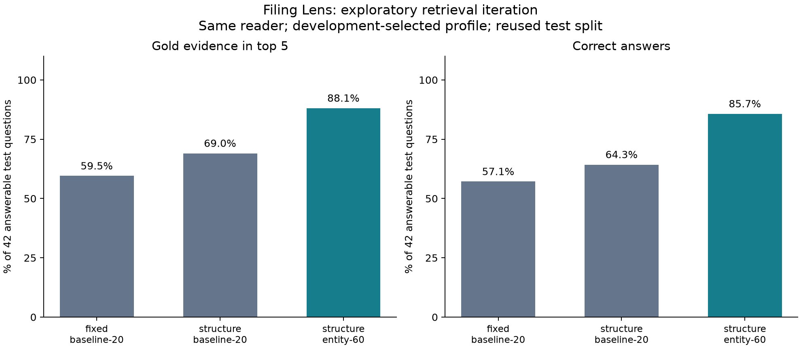
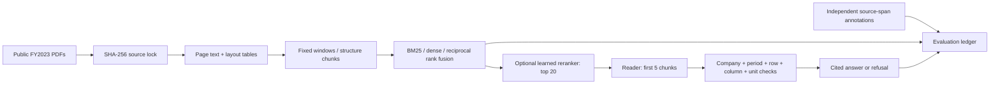

# Filing Lens

**A financial-document RAG benchmark with hybrid search, cross-encoder reranking, and source-verified numeric answers.**


[](https://github.com/Aniket2002/filing-lens/actions/workflows/ci.yml)

A plausible financial answer can cite the wrong company, the wrong fiscal year,
or the right number in the wrong unit. Filing Lens measures where that happens.
It searches **1,275 pages from ten semiconductor issuers**, evaluates **80 individually
written, source-anchored questions**, and preserves every ranking, answer, citation,
refusal, and timing. Everything runs locally on a CPU; no API key is required.

The main study fixes one **extractive reader** across all retrieval ablations.
Separate pinned FLAN-T5-small and FLAN-T5-base experiments measure generated numeric
answers before and after a source-cell guard. A local API exposes answers, refusals,
health, and request metrics. This is a research prototype with no production deployment.
An experimental explanation reader also measures model-native answerability on a
separate set of 40 new, source-anchored questions frozen before inference. Its
generated explanations remain unverified and often incomplete.

**New retrieval iteration:** entity-aware BM25, structure-aware chunks, and a
60-candidate reranker improve test **recall@5 from 59.5% to 88.1%** and **answer
correctness from 57.1% to 85.7%**, with the same reader in both runs. The profile
was selected from six development ablations before test. This is exploratory
evidence on the reused 42-answerable/14-negative test split, not a new holdout.
CPU p95 increased from **1.36 s to 3.25 s**. Query plans, candidate lists, ranking
scores, and failure attribution are preserved for all **312 predictions**.
See the [measured comparison](docs/retrieval-v2/results.md),
[design and reproduction](docs/RETRIEVAL_V2.md), and
[resume bullets and interview guide](docs/RESUME.md).



[View the original 12-configuration ablation plot](docs/report/ablations.png).

**Start here:** [measured ablations](docs/report/ablations.md) ·
[failure analysis](docs/FAILURE_ANALYSIS.md) ·
[experiment protocol](docs/EXPERIMENT_PROTOCOL.md).
Open `docs/report/index.html` locally for the interactive experiment and case-file
review. It is a standalone file; it needs no server and makes no network requests.
[Preview the review interface](docs/report/preview.png).

## What was measured

<!-- RESULTS_START -->
Development selected **`fixed-bm25-rerank`**. Its test recall@5 is **59.5%**, versus 47.6% for fixed/BM25: **+11.9 percentage points** (paired company-bootstrap 95% interval: +2.4 to +21.4 points; seven test companies). Treat this small-sample interval as descriptive, not as evidence of statistical significance or general superiority. Answer correctness is 42.9%, answerable-question coverage is 50.0%, and unanswerable refusal is 78.6%.

The highest observed test recall belongs to `structure-bm25-rerank` (69.0% recall@5; 64.3% answer correctness). It was not selected by the development set, so it remains a descriptive test result.

| Configuration | R@1 | R@5 | R@10 | MRR@20 | Answer correct | Citation support | Refusal (unanswerable) | p95 ms |
| :-- | --: | --: | --: | --: | --: | --: | --: | --: |
| fixed-bm25 | 31.0% | 47.6% | 52.4% | 0.381 | 33.3% | 100.0% | 71.4% | 30 |
| fixed-bm25-rerank | 28.6% | 59.5% | 61.9% | 0.400 | 42.9% | 100.0% | 78.6% | 1402 |
| fixed-dense | 9.5% | 16.7% | 28.6% | 0.144 | 4.8% | 100.0% | 92.9% | 45 |
| fixed-dense-rerank | 21.4% | 35.7% | 40.5% | 0.279 | 23.8% | 100.0% | 92.9% | 1291 |
| fixed-hybrid | 14.3% | 42.9% | 54.8% | 0.269 | 33.3% | 100.0% | 78.6% | 46 |
| fixed-hybrid-rerank | 23.8% | 52.4% | 59.5% | 0.353 | 38.1% | 100.0% | 78.6% | 1315 |
| structure-bm25 | 23.8% | 52.4% | 52.4% | 0.352 | 50.0% | 100.0% | 71.4% | 33 |
| structure-bm25-rerank | 40.5% | 69.0% | 69.0% | 0.520 | 64.3% | 100.0% | 78.6% | 1323 |
| structure-dense | 7.1% | 19.0% | 23.8% | 0.131 | 19.0% | 100.0% | 92.9% | 58 |
| structure-dense-rerank | 16.7% | 31.0% | 31.0% | 0.228 | 33.3% | 100.0% | 85.7% | 1322 |
| structure-hybrid | 14.3% | 35.7% | 57.1% | 0.260 | 35.7% | 100.0% | 78.6% | 59 |
| structure-hybrid-rerank | 31.0% | 59.5% | 59.5% | 0.421 | 57.1% | 100.0% | 78.6% | 1178 |

Citation support is conditional on returning an answer. The selected system returns source-supported but irrelevant answers to three negative questions; 100% citation support therefore does not mean 100% correctness.

**Failed generation pilot, retained:** FLAN-T5-small achieves 0.0% raw amount correctness on the 35 numeric test questions. The guard declines every test answer (0.0% numeric coverage). Its 100% negative refusal rate is degenerate and does not demonstrate useful generative QA. See the failure analysis and preserved raw outputs.

**Current CLI/API reader:** same-page table-evidence assembly is now enabled by default for `ask` and `serve`. The separately measured extractive profile achieves **57.1% correctness (24/42)** and **64.3% coverage (27/42)**, with unchanged retrieval and unanswerable refusal. Use `--no-assemble-table-evidence` for the original reader; benchmark defaults and frozen reference artifacts retain the original behavior. See [Iteration 1](docs/ITERATION_1.md).

**Generation v2, exploratory:** pinned FLAN-T5-base with aligned year/value records achieves **60.0% raw amount correctness (21/35)** and **57.1% verified numeric correctness and coverage (20/35)**. It uses the same retrieval rankings plus table-evidence assembly. The guard withholds one correct raw amount without sufficient retrieved evidence. The model's exact `UNKNOWN` rate on 14 negatives is **0/14**; guarded refusals come from the controls. This is row-assisted amount generation on a previously inspected test set, with model, prompt, context format, and evidence assembly changed together. It is not an independent validation, a controlled model-size comparison, or general financial QA. See the [generation study](docs/GENERATION_V2.md) and [preserved outputs](results/generator-v2/test/predictions.jsonl).

**New explanation challenge, supplied evidence:** 40 new AI-authored questions (8 development, 32 test) were frozen before inference using the same source filings. The experimental `flan-t5-explain` reader generates prose and its own yes/no answerability decision without the extractive reader or numeric guard. On test it declines **93.8% of unsupported questions (15/16)** and falsely declines **1/16 supported questions**. Explanation quality remains weak: only **6/16** supported questions pass the full automatic concept screen, which is not a correctness or entailment score. Human quality scores remain unassigned. This isolates model behavior on supplied passages; it does not evaluate retrieval or establish independent human validation. See the [explanation study](docs/EXPLANATION_STUDY.md).
<!-- RESULTS_END -->

The complete metric ledger includes recall@1/5/10, MRR@20, numeric and narrative
correctness, citation support, gold-citation accuracy, coverage, false refusals,
unanswerable refusal rate, and latency. The primary test set has **42 answerable
and 14 unanswerable questions across seven held-out companies**. Development uses
NVDA, AMD, and Intel: 18 answerable and 6 unanswerable questions. All ten reports
remain searchable in every configuration.

**Evaluation limits.** Questions were AI-authored after source inspection
and have not been independently human-adjudicated. Numeric questions cover five
repeated metric types; half the negatives are easy future-period questions. A high
citation-support rate is conditional on answering and does not imply high coverage
or relevance. The dataset is a narrow, inspectable benchmark, and the selected
system's absolute answer quality remains modest. See the
[failure analysis](docs/FAILURE_ANALYSIS.md) for the measured failure modes,
[dataset card](docs/DATA_CARD.md) for limitations and annotation provenance, and
[experiment protocol](docs/EXPERIMENT_PROTOCOL.md) for uncertainty and selection details.

## Reproduce it

Install [uv](https://docs.astral.sh/uv/getting-started/installation/), then run from
the repository root. Python 3.12 is selected explicitly; the lockfile uses CPU PyTorch.

```bash
uv sync --locked --extra dev --python 3.12

# Fast checks: no source PDFs, model downloads, or inference required
uv run pytest -q
uv run python scripts/audit_reference.py
uv run python scripts/audit_generation_results.py
uv run python scripts/audit_explanation_results.py
uv run python scripts/audit_retrieval_results.py

# Acquire the exact source documents and build the canonical corpus
uv run filing-lens fetch
uv run filing-lens parse
uv run filing-lens validate

# Run the full 2 x 3 x 2 experiment into a separate output directory
uv run filing-lens benchmark --output results/reproduced
uv run filing-lens report --results results/reproduced --output docs/reproduced
```

Allow several minutes for parsing/indexing and substantially longer for all CPU
reranking runs. The first run downloads approximately 90 MB of filings plus model
weights; exact source sizes and measured runtime are recorded in the locks and run
metadata. Embeddings are content-addressed and cached. Re-running keeps reference
results intact unless you explicitly choose their output directory.

For a smaller run without embedding or reranker downloads:

```bash
uv run filing-lens benchmark --lexical-only --output results/lexical
```

Downloading and parsing are explicit steps. Unit tests and the committed-result
audit never access the network. Frozen validation fails on changed source bytes,
annotation files, questions, or canonical extraction. The annotation materializer
is deliberately excluded from the reproduction commands: changing gold labels to
fit a new parser is a dataset revision, not reproduction.

## Ask a source-cited question

After `fetch` and `parse`, retrieval defaults to the development-selected reference
configuration. The live reader enables the measured same-page table-evidence
improvement. The question-answering path does not read question labels, gold answers,
or annotations.

```bash
uv run filing-lens ask "What was Micron Technology's FY2023 revenue in USD millions?"
uv run filing-lens ask "What diluted earnings per common share did Analog Devices report in FY2023?" --config structure-bm25-rerank --json
uv run filing-lens ask "What was NVIDIA's FY2028 revenue?"

# New development-selected retrieval profile; defaults preserve the reference profile
uv run filing-lens ask "What was Micron Technology's FY2023 revenue in USD millions?" --config structure-bm25-rerank --retrieval-profile entity --candidate-pool 60 --json

# Override retrieval, or try the optional local amount-only generator
uv run filing-lens ask "What was AMD's FY2023 net income?" --config structure-bm25-rerank
uv run filing-lens ask "What was AMD's FY2023 net income?" --reader flan-t5
uv run filing-lens ask "What was AMD's FY2023 net income?" --reader flan-t5-base
uv run filing-lens ask "Explain how in-house manufacturing supports Texas Instruments' cost and supply-chain strategy." --reader flan-t5-explain

# Reproduce the original extractive reader behavior
uv run filing-lens ask "What was AMD's FY2023 net income?" --no-assemble-table-evidence
```

Answers include a one-based PDF page, exact evidence quote, source URL, and numeric
check results. A refusal records the failed evidence gate. A numeric question
requires complete retrieved header and row evidence on the same PDF page; having
the number somewhere in the global corpus is insufficient.

The local generative audit can be reproduced separately:

```bash
uv run python scripts/audit_generator.py
```

It reuses the reference retrieval rankings, scores **50 numeric + 20 unanswerable**
questions, preserves raw outputs, and excludes the ten narrative questions. It uses
complete retrieved rows when available and is explicitly a row-assisted experiment.
See [generator results](results/generator/metrics.json) for its own denominators.

The new experiment runs development first and refuses changed implementation or
inputs before test. Choose an unused output directory; existing results cannot be
overwritten by this runner.

```bash
uv run python scripts/audit_generator_v2.py --split dev --output results/reproduced/generator-v2
uv run python scripts/audit_generator_v2.py --split test --output results/reproduced/generator-v2
```

It downloads approximately 1 GB of FLAN-T5-base weights on first use. Both readers
generate an amount from retrieved rows; the final sentence is a deterministic
rendering of the verified claim. Neither is a general narrative-generation system.
The separate `flan-t5-explain` reader generates prose and its own answerability
decision from evidence. Its source references identify input context; they do not
certify the explanation's correctness. See the [explanation study](docs/EXPLANATION_STUDY.md).

## Local service and independent review

```bash
uv run filing-lens serve --reader flan-t5-base
```

Send JSON `{"question":"What was AMD's FY2023 net income?"}` to
`POST http://127.0.0.1:8000/ask`. `GET /health`, `/ready`, and `/metrics` expose
service health, loaded profile, and request/error/refusal/latency counters. Logs
include request IDs and evidence-gate reasons. See [API usage and operational
limits](docs/SERVICE.md). The service runs locally; production hosting and external
monitoring remain unimplemented.

[The review sheet](data/review/pending.csv) contains all 80 source-linked questions
with blank adjudication fields: **0 independently reviewed, 80 pending**. The
[review workflow](docs/ANNOTATION_REVIEW.md) validates recorded decisions, requires
visual-PDF or XBRL checks for numeric labels, and saves proposed corrections
separately. It does not turn an AI-authored benchmark into a human-validated one.
The new explanation challenge has its own 40-row pending review sheet; those
labels and the generated prose also await independent human assessment.
The [answer review workflow](docs/ANSWER_REVIEW.md) now exports the 40 saved model
responses with their exact input context, validates separate correctness,
completeness, and claim-support judgments, and reports scored and pending counts
for each split. All 40 response reviews remain pending; quality rates remain null.
The API bounds inference admission and queue waiting, returning retryable 503
responses under load and exposing overload and queue-time metrics.

## Architecture and design choices



| Choice | Implementation and reason |
| :-- | :-- |
| Same canonical corpus | Both chunkers see identical extracted text and normalized table views; gold stays anchored to source spans. |
| Small exact index | NumPy cosine search avoids ANN parameters at this scale. |
| Real pretrained models | Pinned MiniLM bi-encoder and MS MARCO cross-encoder; no simulated dense or reranker scores. |
| Rank fusion | RRF combines ranks without pretending BM25 and cosine scores share a scale. |
| Metadata-aware candidates | Optional query-only entity routing constrains both lexical and dense retrieval before candidate truncation; comparative filing years stay searchable. |
| Ranking diagnostics | Candidate recall, per-stage scores, and promotion/demotion traces distinguish retrieval misses from reranker failures. |
| Frozen answerer | Retrieval changes cannot be confused with reader changes. |
| Explicit abstention | No answer without sufficient evidence; refusal and coverage are both scored. |
| Decimal controls | Parentheses, signs, cents, millions, thousands, and per-share units are checked without float equality. |
| Company-held-out questions | Repeated metric questions from one issuer stay in the same split; selection never reads test metrics. |
| Paired cluster bootstrap | Resamples companies together to reflect within-issuer dependence. |
| Offline result audit | Recomputes published aggregates, retrieval metrics, and source-cell checks from committed artifacts. |

The structure chunker preserves rows and repeats headers; the fixed chunker uses
160-word windows with 32-word overlap. Different chunk counts, repeated-header
overhead, model truncation, and enriched table duplication are disclosed confounds.
The source-cell verifier shares the parser with the reader: agreement cannot prove
that a PDF cell was extracted correctly. Visual/XBRL reconciliation is future work.

## Deterministic controls

The isolated verifier study passes **500/500 cases**: 50 valid source-cell claims
and 450 corruptions across nine mutation types. It rejects wrong amounts, signs,
periods, units, entities, pages, metrics, column indexes, and displayed amounts
that disagree with structured claims. This is a test of the controls given a
correct source cell, **not a 100% end-to-end QA claim**.

```bash
uv run python scripts/audit_numeric_controls.py
uv run pytest -q
uv run ruff check .
uv run ruff format --check .
```

CI runs offline tests and reference-result audits on Windows and Linux, but does
not download the corpus or rerun neural inference. The badge above tracks the
`main` branch workflow status.

## Repository map

```text
data/annotations.json         Independently specified questions and expected values
data/questions.jsonl          Frozen questions and source-span gold passages
data/*-lock.json              Source, model, generator, and benchmark provenance
data/evidence/                Small parsed-statement audit fixtures
src/filing_lens/              Parsing, chunking, retrieval, reader, controls, evaluation
results/reference/           All 960 main predictions, 36 aggregate rows, run metadata
results/retrieval-v2/        312 exploratory predictions, query plans, stage scores, dev-first selection
results/generator/           Raw local-model outputs and guarded answer metrics
results/generator-v2/        Dev-first FLAN-T5-base outputs, fingerprints, and metrics
results/explanations/        New supplied-passage explanation and native-refusal study
data/explanations/           Frozen new questions, model/protocol locks, pending review
data/review/                 Pending source-linked review sheet and explicit status
results/controls/            Isolated source-cell mutation study
docs/report/                 Standalone interactive report, plot, and failure ledger
docs/retrieval-v2/           New measured comparison, plot, recovered cases, and remaining failures
docs/RESUME.md               Evidence-backed resume bullets and interview discussion guide
tests/                       Offline behavior, leakage, parsing, and tampering checks
```

The reports are historical, issuer fiscal years differ, and results do not establish
investment-research reliability. Full source PDFs, model weights, and caches are
excluded from Git. Code is [MIT licensed](LICENSE); see [attributions](NOTICE.md),
including the separate licensing terms for PyMuPDF.
