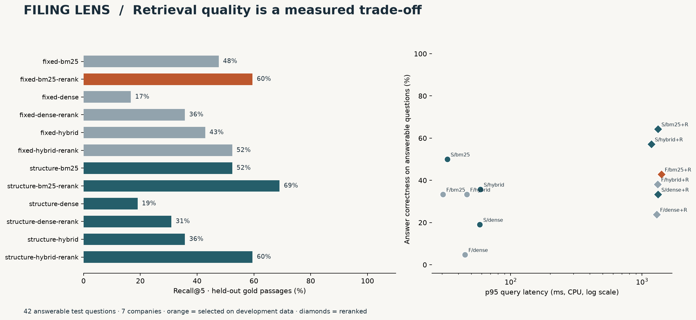
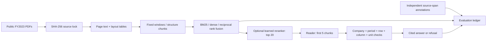

# Filing Lens

**A measured filings Q&A system: twelve retrieval configurations, source-linked answers, and deterministic numeric controls.**


A plausible financial answer can cite the wrong company, the wrong fiscal year,
or the right number in the wrong unit. Filing Lens measures where that happens.
It searches **1,275 pages from ten semiconductor issuers**, evaluates **80 individually
written, source-anchored questions**, and preserves every ranking, answer, citation,
refusal, and timing. Everything runs locally on a CPU; no API key is required.

The main study fixes one **extractive reader** across all retrieval ablations.
A separate pinned FLAN-T5-small experiment measures generated numeric answers before
and after a source-cell guard. Neither result is presented as a production assistant.



**Start here:** [measured ablations](docs/report/ablations.md) ·
[failure analysis](docs/FAILURE_ANALYSIS.md) ·
[experiment protocol](docs/EXPERIMENT_PROTOCOL.md) ·
[interview walkthrough](docs/INTERVIEW_GUIDE.md).
Open `docs/report/index.html` locally for the interactive experiment and case-file
review. It is a standalone file; it needs no server and makes no network requests.
[Preview the review interface](docs/report/preview.png).

## What was measured

<!-- RESULTS_START -->
Development selected **`fixed-bm25-rerank`**. Its test recall@5 is **59.5%**, versus 47.6% for fixed/BM25: **+11.9 percentage points** (paired company-bootstrap 95% interval: +2.4 to +21.4 points; seven test companies). Answer correctness is 42.9%, answerable-question coverage is 50.0%, and unanswerable refusal is 78.6%.

The highest observed test recall belongs to `structure-bm25-rerank` (69.0% recall@5; 64.3% answer correctness). It was not selected by the development set, so it remains a descriptive test result.

| Configuration | R@1 | R@5 | R@10 | MRR@20 | Answer correct | Citation support | Refusal (unanswerable) | p95 ms |
| :-- | --: | --: | --: | --: | --: | --: | --: | --: |
| fixed-bm25 | 31.0% | 47.6% | 52.4% | 0.381 | 33.3% | 100.0% | 71.4% | 30 |
| fixed-bm25-rerank | 28.6% | 59.5% | 61.9% | 0.400 | 42.9% | 100.0% | 78.6% | 1402 |
| fixed-dense | 9.5% | 16.7% | 28.6% | 0.144 | 4.8% | 100.0% | 92.9% | 45 |
| fixed-dense-rerank | 21.4% | 35.7% | 40.5% | 0.279 | 23.8% | 100.0% | 92.9% | 1291 |
| fixed-hybrid | 14.3% | 42.9% | 54.8% | 0.269 | 33.3% | 100.0% | 78.6% | 46 |
| fixed-hybrid-rerank | 23.8% | 52.4% | 59.5% | 0.353 | 38.1% | 100.0% | 78.6% | 1315 |
| structure-bm25 | 23.8% | 52.4% | 52.4% | 0.352 | 50.0% | 100.0% | 71.4% | 33 |
| structure-bm25-rerank | 40.5% | 69.0% | 69.0% | 0.520 | 64.3% | 100.0% | 78.6% | 1323 |
| structure-dense | 7.1% | 19.0% | 23.8% | 0.131 | 19.0% | 100.0% | 92.9% | 58 |
| structure-dense-rerank | 16.7% | 31.0% | 31.0% | 0.228 | 33.3% | 100.0% | 85.7% | 1322 |
| structure-hybrid | 14.3% | 35.7% | 57.1% | 0.260 | 35.7% | 100.0% | 78.6% | 59 |
| structure-hybrid-rerank | 31.0% | 59.5% | 59.5% | 0.421 | 57.1% | 100.0% | 78.6% | 1178 |

Citation support is conditional on returning an answer. The selected system returns source-supported but irrelevant answers to three negative questions; 100% citation support therefore does not mean 100% correctness.

**Failed generation pilot, retained:** FLAN-T5-small achieves 0.0% raw amount correctness on the 35 numeric test questions. The guard declines every test answer (0.0% numeric coverage). Its 100% negative refusal rate is degenerate and does not demonstrate useful generative QA. See the failure analysis and preserved raw outputs.
<!-- RESULTS_END -->

The complete metric ledger includes recall@1/5/10, MRR@20, numeric and narrative
correctness, citation support, gold-citation accuracy, coverage, false refusals,
unanswerable refusal rate, and latency. The primary test set has **42 answerable
and 14 unanswerable questions across seven held-out companies**. Development uses
NVDA, AMD, and Intel: 18 answerable and 6 unanswerable questions. All ten reports
remain searchable in every configuration.

**Evaluation limits.** Questions were AI-authored after source inspection
and have not been independently human-adjudicated. Numeric questions cover five
repeated metric types; half the negatives are easy future-period questions. A high
citation-support rate is conditional on answering and does not imply high coverage
or relevance. The dataset is a narrow, inspectable benchmark. See the
[dataset card](docs/DATA_CARD.md) for limitations and annotation provenance.

## Reproduce it

Install [uv](https://docs.astral.sh/uv/getting-started/installation/), then run from
the repository root. Python 3.12 is selected explicitly; the lockfile uses CPU PyTorch.

```bash
uv sync --locked --extra dev --python 3.12

# Fast checks: no source PDFs, model downloads, or inference required
uv run pytest -q
uv run python scripts/audit_reference.py

# Acquire the exact source documents and build the canonical corpus
uv run filing-lens fetch
uv run filing-lens parse
uv run filing-lens validate

# Run the full 2 x 3 x 2 experiment into a separate output directory
uv run filing-lens benchmark --output results/reproduced
uv run filing-lens report --results results/reproduced --output docs/reproduced
```

Allow several minutes for parsing/indexing and substantially longer for all CPU
reranking runs. The first run downloads approximately 90 MB of filings plus model
weights; exact source sizes and measured runtime are recorded in the locks and run
metadata. Embeddings are content-addressed and cached. Re-running keeps reference
results intact unless you explicitly choose their output directory.

For a smaller run without embedding or reranker downloads:

```bash
uv run filing-lens benchmark --lexical-only --output results/lexical
```

Downloading and parsing are explicit steps. Unit tests and the committed-result
audit never access the network. Frozen validation fails on changed source bytes,
annotation files, questions, or canonical extraction. The annotation materializer
is deliberately excluded from the reproduction commands: changing gold labels to
fit a new parser is a dataset revision, not reproduction.

## Ask a source-cited question

After `fetch` and `parse`, the default configuration is selected from development
results stored in the reference run. The question-answering path does not read
question labels, gold answers, or annotations.

```bash
uv run filing-lens ask "What was Micron Technology's FY2023 revenue in USD millions?"
uv run filing-lens ask "What diluted earnings per common share did Analog Devices report in FY2023?" --config structure-bm25-rerank --json
uv run filing-lens ask "What was NVIDIA's FY2028 revenue?"

# Override retrieval, or try the optional local amount-only generator
uv run filing-lens ask "What was AMD's FY2023 net income?" --config structure-bm25-rerank
uv run filing-lens ask "What was AMD's FY2023 net income?" --reader flan-t5
```

Answers include a one-based PDF page, exact evidence quote, source URL, and numeric
check results. A refusal records the failed evidence gate. A numeric question
requires complete retrieved header and row evidence; having the number somewhere
in the global corpus is insufficient.

The local generative audit can be reproduced separately:

```bash
uv run python scripts/audit_generator.py
```

It reuses the reference retrieval rankings, scores **50 numeric + 20 unanswerable**
questions, preserves raw outputs, and excludes the ten narrative questions. It uses
complete retrieved rows when available and is explicitly a row-assisted experiment.
See [generator results](results/generator/metrics.json) for its own denominators.

## Architecture and design choices



| Choice | Implementation and reason |
| :-- | :-- |
| Same canonical corpus | Both chunkers see identical extracted text and normalized table views; gold stays anchored to source spans. |
| Small exact index | NumPy cosine search avoids ANN parameters at this scale. |
| Real pretrained models | Pinned MiniLM bi-encoder and MS MARCO cross-encoder; no simulated dense or reranker scores. |
| Rank fusion | RRF combines ranks without pretending BM25 and cosine scores share a scale. |
| Frozen answerer | Retrieval changes cannot be confused with reader changes. |
| Explicit abstention | No answer without sufficient evidence; refusal and coverage are both scored. |
| Decimal controls | Parentheses, signs, cents, millions, thousands, and per-share units are checked without float equality. |
| Company-held-out questions | Repeated metric questions from one issuer stay in the same split; selection never reads test metrics. |
| Paired cluster bootstrap | Resamples companies together to reflect within-issuer dependence. |
| Offline result audit | Recomputes published aggregates, retrieval metrics, and source-cell checks from committed artifacts. |

The structure chunker preserves rows and repeats headers; the fixed chunker uses
160-word windows with 32-word overlap. Different chunk counts, repeated-header
overhead, model truncation, and enriched table duplication are disclosed confounds.
The source-cell verifier shares the parser with the reader: agreement cannot prove
that a PDF cell was extracted correctly. Visual/XBRL reconciliation is future work.

## Deterministic controls

The isolated verifier study passes **500/500 cases**: 50 valid source-cell claims
and 450 corruptions across nine mutation types. It rejects wrong amounts, signs,
periods, units, entities, pages, metrics, column indexes, and displayed amounts
that disagree with structured claims. This is a test of the controls given a
correct source cell, **not a 100% end-to-end QA claim**.

```bash
uv run python scripts/audit_numeric_controls.py
uv run pytest -q
uv run ruff check .
uv run ruff format --check .
```

CI runs offline tests and reference-result audits on Windows and Linux. It does
not download the corpus or rerun neural inference. Actual CI status is visible
once the repository is published and its workflow has run.

## Repository map

```text
data/annotations.json         Independently specified questions and expected values
data/questions.jsonl          Frozen questions and source-span gold passages
data/*-lock.json              Source, model, generator, and benchmark provenance
data/evidence/                Small parsed-statement audit fixtures
src/filing_lens/              Parsing, chunking, retrieval, reader, controls, evaluation
results/reference/           All 960 main predictions, 36 aggregate rows, run metadata
results/generator/           Raw local-model outputs and guarded answer metrics
results/controls/            Isolated source-cell mutation study
docs/report/                 Standalone interactive report, plot, and failure ledger
tests/                       Offline behavior, leakage, parsing, and tampering checks
```

The reports are historical, issuer fiscal years differ, and results do not establish
investment-research reliability. Full source PDFs, model weights, and caches are
excluded from Git. Code is [AGPL-3.0-or-later](LICENSE); see [attributions](NOTICE.md).
