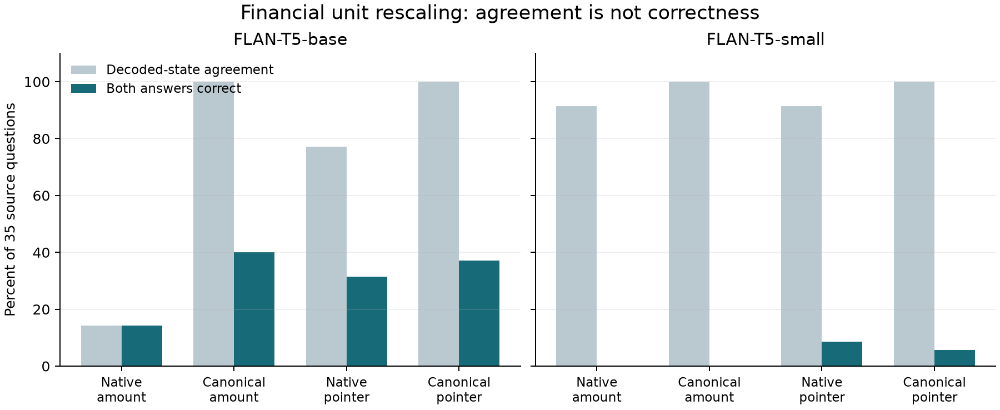

# Financial Evidence Equivariance: Separating Numerical Fidelity from Evidence Selection in Financial RAG

Research pilot, 23 October 2026. Author list and affiliations pending review. Not peer reviewed or submitted. Candidate contribution; priority not established.

## Abstract

An amount can remain numerically plausible while losing its connection to a fiscal year, reporting scale, or source cell. We investigate this distinction through a typed intervention study of financial retrieval-augmented generation (RAG). Starting from 50 source-anchored questions across ten semiconductor issuers, we construct 600 cases that separate presentation changes from evidence changes, under annotated-page and retrieved-page evidence. We cross native versus canonical financial records with amount versus cell-identifier decoding, using two pinned local instruction-tuned language models. A paired usable score requires correct numeric answers on both the original and transformed case, preventing refusal or consistent error from counting as success. The study records 4,800 evaluation outcomes from 2,252 distinct-prompt inference calls. On the seven test companies, the prespecified base-model contrast under monetary-unit rescaling is +22.9 percentage points, with a descriptive company-bootstrap 95% interval of [+5.7, +40.0]. Canonical-pointer paired usable accuracy is 37.1%, compared with 14.3% for native-amount and 40.0% for canonical-amount decoding. Original-input accuracy is 62.9% for native-amount versus 37.1% for canonical-pointer. Evidence-removal refusal accuracy is 0.0% for every base-model arm. Preserving-transform robustness therefore cannot stand in for ordinary accuracy or sensitivity to missing support. Canonicalization guarantees input invariance for the specified preserving transformations; this guarantee does not establish answer correctness. The contribution is a reproducible financial response-profile experiment and a controlled mechanism analysis, not a claim to invent cell selection or metamorphic testing.

## 1. Introduction

Financial question answering requires identifying a quantity together with its meaning. An income figure expressed in thousands is not interchangeable with the same surface numeral expressed in millions. Nor is a genuine FY2022 amount a valid answer to a FY2023 question. Retrieval can return the appropriate statement while generation still confuses the row, period, or unit. A single answer-accuracy score does not reveal whether a model follows evidence, copies a familiar numeral, or becomes insensitive to changes in support.

We study a narrower question than general financial reasoning: how should a system respond when the evidence representation changes, when a fiscal-year binding changes, and when the requested evidence is removed? These three situations require different behavior. A robust system should preserve economic quantities across unit and ordering changes, update an answer under a changed binding, and abstain when support is absent.

The proposed research contribution has three components. First, we instantiate these response obligations as executable, dimension-aware transformations of provenance-bearing financial cells. Second, we evaluate paired useful correctness alongside consistency and refusal behavior, so invariance cannot be mistaken for competence. Third, we use a factorial comparison to separate canonical evidence presentation from coordinate-first output. The work is deliberately a pilot: it establishes an executable experiment and falsifiable hypotheses, with independent annotation and external evaluation still pending.

## 2. Related work and scope of originality

Table-cell selection substantially predates this project. TaPas selects cells and can apply an aggregation operation [1](https://aclanthology.org/2020.acl-main.398/). TAT-QA and TAGOP combine financial table/text evidence with symbolic reasoning [2](https://aclanthology.org/2021.acl-long.254/). Financial mathematical reasoning evaluation has also examined table complexity and arithmetic demands [3](https://aclanthology.org/2024.findings-acl.231/). We inherit the separation between selecting evidence and executing numeric operations; emitting a cell identifier is not itself a new contribution.

The closest methodological precedent is metamorphic testing of RAG under corpus mutations, including financial data [4](https://arxiv.org/abs/2607.26843). That work already considers preserved facts, changed evidence, and fallback behavior. Our candidate distinction is the specific joint use of dimension-typed financial transformations, exact cell provenance, a paired usable objective, and a decoding-factor experiment. This distinction is an incremental research hypothesis requiring broader literature review, not proof of a first-ever method.

Financial Evidence Crowding studies controlled incompatibility among retrieved candidates and score correction [5](https://arxiv.org/abs/2609.35782). Our current intervention is downstream of frozen retrieval, so we neither replace that ranking study nor demonstrate index-level robustness. Work on imperfect tables studies how row position and error handling affect QA [6](https://arxiv.org/abs/2610.04687). Our protocol instead uses known transformations with executable numeric oracles, avoiding an LLM judge. The broader novelty assessment and explicit failure conditions for the contribution are maintained alongside this manuscript.

## 3. Typed evidence and response obligations

Let an evidence cell be e = (d, m, t, u, v, p), where d identifies the issuer document, m the metric, t the fiscal period, u the dimension and display scale, v the signed decimal value, and p the source coordinate. Monetary cells have scales 1, 1,000, or 1,000,000 USD; per-share cells have a separate dimension. A question requests a metric, issuer, fiscal period, and output unit. Extraction supplies the five supported metric families from each visible page without using the expected answer to select a row.

For source scale s and target scale s', exact conversion is v' = v × s / s'. Per-share values never inherit the monetary scale of the statement. We use Decimal arithmetic and reject incompatible dimensions. The transformation changes the display representation, not the underlying economic quantity.

The intervention family contains the original case and five variants. Column reversal changes the order of cells within each row. Unit rescaling changes all monetary cells between thousands and millions while preserving per-share values. Their composition combines both operations. Period rebinding cyclically rotates the year headers while retaining the physical cell values, inducing a changed answer. Period removal deletes every visible cell for the requested year. Rebinding is intentionally synthetic and need not satisfy accounting identities; it tests evidence dependence rather than simulating a real restatement.

Per-share questions act as a negative control for target-unit scaling: their requested cell does not change scale, although monetary distractors do. The primary denominator includes all five metric families. A supplementary metric breakdown exposes this heterogeneity rather than treating all scale interventions as identical arithmetic tasks.

Canonicalization C converts monetary cells to the requested monetary unit, or USD millions when the question asks for a per-share quantity, then sorts cells by issuer, metric, fiscal period, and source identity. Opaque cell identifiers are allocated from source coordinates using a fixed seeded permutation independent of gold answers. The identifiers persist across transformations.

For a preserving transformation T in the reversal/rescaling family, C(T(E)) = C(E). This follows because exact scale conversion recovers the same economic value and sorting removes presentation order. Thus, for deterministic inference f, f(C(T(E))) = f(C(E)). This is a construction guarantee about the input pipeline, not an empirical discovery about learned financial reasoning. It allows a system to be consistently wrong. Rebinding and removal intentionally do not satisfy this equality.

## 4. Coordinate-first decoding and ablations

We compare four arms: native-amount, canonical-amount, native-pointer, and canonical-pointer. Every arm sees the same available cells and their identifiers. The native arms retain source order and display units. The canonical arms apply C. Amount decoding requests one signed number in the question's requested unit. Pointer decoding requests one visible cell ID; a deterministic executor then converts the selected cell to that unit.

A pointer output has useful but limited guarantees. A valid compatible-dimension ID renders a value from visible evidence with exact conversion; it cannot invent a new numeral. The model can nevertheless choose the wrong metric or period. No answer key, gold source location, or target ID enters the inference function, and the executor does not repair a wrong selection. Unknown IDs, incompatible dimensions, malformed numeric outputs, and explicit UNKNOWN are recorded separately. Only the exact UNKNOWN response is treated as successful abstention on missing evidence.

The two canonicalization operations are bundled in this pilot. The factorial design separates that bundle from the output format, but cannot independently attribute effects to sorting versus unit conversion. An expanded experiment must include these two ablations separately. Likewise, pointer output length, tokenization, and instruction wording differ from amount output; observed differences are properties of the complete decoding interfaces, not a pure causal effect of symbolic reasoning.

## 5. Experimental protocol

The source collection contains FY2023 annual reports from ten semiconductor issuers and comparative values from earlier fiscal years. The existing benchmark contributes 50 numeric questions spanning revenue, net income, research and development, total assets, and diluted earnings per share. Three companies provide 15 development questions; seven provide 35 test questions. The same test companies were used in earlier repository studies, so the current freeze does not create a fresh independent holdout.

Each question is evaluated with two evidence sources. The oracle-page condition exposes the annotated source page's supported typed rows. The retrieved-pages condition exposes supported typed rows from the top five ranked chunks' pages in the frozen entity-aware BM25/cross-encoder run. Gold pages are never inserted into this condition. Full-page table expansion and the restricted five-metric schema make this a structured evidence adapter, not raw chunk-only generation. For the original questions, 50 of 50 retrieved evidence sets contain a matching source fact; this coverage is not the earlier span-level Recall@5 metric.

Crossing 50 questions, two sources, and six variants yields 600 cases. Four arms and two models produce 4,800 outcomes. FLAN-T5-base and FLAN-T5-small [7](https://arxiv.org/abs/2210.11416) use pinned revisions, greedy decoding, a fixed seed, and no fine-tuning. Input length is checked against a 2,048-token ceiling before inference; the observed maximum is 539 tokens. No context is silently truncated. Both models belong to one family and are small relative to contemporary general-purpose LLMs.

Protocol, implementation, source evidence, dependency lock, frozen retrieval predictions, and the constructed dataset are fingerprinted before inference. The initial freeze is preserved in repository commit 53a7d02. There is no model or arm selection after development: all four arms and both models are published. Identical prompts within a run reuse the deterministic output, so evaluation outcomes must not be described as independent inference calls or stochastic replicates. Each test run follows its corresponding development run.

For original and preserving variants, paired usable accuracy is the mean of I(original correct numeric) × I(transformed correct numeric), over all source questions. Incorrect answers and refusals both score zero. We additionally report single-case task accuracy, context correctness, numeric coverage, invalid outputs, and decoded-state agreement. Agreement compares the decoded value and status, so different malformed strings can collapse to the same invalid state; all raw outputs remain available. It is deliberately a weak diagnostic, not a correctness criterion. Missing evidence may justify abstention under context correctness while still failing a task that asks for a known source quantity. Removal cases instead require explicit UNKNOWN. Period-rebinding accuracy is scored against the transformed evidence oracle.

The primary score is numerical, so coincidentally identical values can conceal selection of a wrong cell. Pointer-coordinate correctness is therefore recorded separately: an ID must identify a matching issuer, metric, period, and transformed value. A repeated disclosure with the same fact can supply an alternative valid coordinate. Amount-only outputs do not identify their source cell, so coordinate accuracy is not assigned to those arms. The requested output unit is supplied from the benchmark's unit annotation; this pilot does not evaluate free-form unit-intent parsing.

The prespecified primary contrast is canonical-pointer minus native-amount paired usable accuracy under unit rescaling, with retrieved evidence and the base model on test companies. Its uncertainty uses 2,000 paired company-cluster bootstrap resamples with seed 17. Every test company supplies five source questions; transformed cases are not treated as independent samples. With only seven clusters, intervals are descriptive and coarse. Secondary arms, variants, and the small model are diagnostic comparisons without multiplicity-adjusted significance claims.

## 6. Results

Canonical-pointer paired usable accuracy is 37.1%, compared with 14.3% for native-amount and 40.0% for canonical-amount decoding. The primary difference is +22.9 percentage points (descriptive 95% interval +5.7 to +40.0). The small-model contrast is +5.7 points (+0.0 to +17.1). These are pilot estimates on reused companies, not external validation. Canonical-amount matches or exceeds canonical-pointer on the primary condition; this experiment does not establish an additional benefit from pointer output. Original-input accuracy is 62.9% for native-amount versus 37.1% for canonical-pointer. Evidence-removal refusal accuracy is 0.0% for every base-model arm. Preserving-transform robustness therefore cannot stand in for ordinary accuracy or sensitivity to missing support.

Table 1 reports test results with retrieved evidence. Base is single-case numeric correctness. Scale, reverse, and combined are paired usable percentages. Rebind is correctness under changed year bindings. Removal is explicit correct abstention. Every cell has 35 underlying source questions, not 210 independent observations.

| Model | Arm | Base % | Scale % | Reverse % | Both % | Rebind % | Removal % |
| --- | --- | --- | --- | --- | --- | --- | --- |
| base | Native amount | 62.9 | 14.3 | 34.3 | 11.4 | 57.1 | 0.0 |
| base | Canonical amount | 40.0 | 40.0 | 40.0 | 40.0 | 42.9 | 0.0 |
| base | Native pointer | 37.1 | 31.4 | 20.0 | 20.0 | 34.3 | 0.0 |
| base | Canonical pointer | 37.1 | 37.1 | 37.1 | 37.1 | 40.0 | 0.0 |
| small | Native amount | 0.0 | 0.0 | 0.0 | 0.0 | 2.9 | 17.1 |
| small | Canonical amount | 0.0 | 0.0 | 0.0 | 0.0 | 0.0 | 28.6 |
| small | Native pointer | 8.6 | 8.6 | 2.9 | 2.9 | 2.9 | 17.1 |
| small | Canonical pointer | 5.7 | 5.7 | 5.7 | 5.7 | 8.6 | 17.1 |

Table 2 provides the corresponding oracle-page diagnostic. Differences between these tables include the distractor cells exposed by the evidence adapters; they should not be attributed only to gold-page retrieval misses.

| Model | Arm | Base % | Scale % | Reverse % | Both % | Rebind % | Removal % |
| --- | --- | --- | --- | --- | --- | --- | --- |
| base | Native amount | 68.6 | 14.3 | 31.4 | 11.4 | 51.4 | 0.0 |
| base | Canonical amount | 42.9 | 42.9 | 42.9 | 42.9 | 42.9 | 0.0 |
| base | Native pointer | 37.1 | 34.3 | 17.1 | 17.1 | 37.1 | 0.0 |
| base | Canonical pointer | 40.0 | 40.0 | 40.0 | 40.0 | 40.0 | 0.0 |
| small | Native amount | 0.0 | 0.0 | 0.0 | 0.0 | 0.0 | 22.9 |
| small | Canonical amount | 0.0 | 0.0 | 0.0 | 0.0 | 0.0 | 25.7 |
| small | Native pointer | 11.4 | 8.6 | 2.9 | 2.9 | 2.9 | 20.0 |
| small | Canonical pointer | 2.9 | 2.9 | 2.9 | 2.9 | 5.7 | 20.0 |

Figure 1. Test-company decoded-state agreement and paired usable accuracy under unit rescaling with retrieved evidence. Canonical input equality makes agreement structural; usefulness remains an empirical question. Cached identical prompts contribute no additional stochastic evidence.

A recorded regression is adi-numeric-01 with base/native_amount. Its original answer is correct, but after synthetic unit rescaling the model outputs `12305.539`; the required value remains 12305539 USD thousands. The report includes every such scale regression, not just this illustration.

Table 3 separates numerical correctness from coordinate correctness for pointer outputs with retrieved evidence. Invalid includes unknown IDs and incompatible dimensions. Numeric agreement alone is insufficient evidence of correct binding.

| Model | Arm | Variant | Numeric % | Coordinate % | Invalid % |
| --- | --- | --- | --- | --- | --- |
| base | native pointer | base | 37.1 | 37.1 | 28.6 |
| base | native pointer | period rebind | 34.3 | 34.3 | 22.9 |
| base | canonical pointer | base | 37.1 | 37.1 | 22.9 |
| base | canonical pointer | period rebind | 40.0 | 40.0 | 25.7 |
| small | native pointer | base | 8.6 | 8.6 | 65.7 |
| small | native pointer | period rebind | 2.9 | 2.9 | 62.9 |
| small | canonical pointer | base | 5.7 | 5.7 | 68.6 |
| small | canonical pointer | period rebind | 8.6 | 8.6 | 60.0 |

Full per-question predictions preserve raw model output, decoded value or ID, invalid-output state, prompt fingerprint, token count, evidence source, intervention, and scoring fields. All aggregate tables are regenerated from these outcomes and checked against the saved metrics. This audit establishes internal consistency and provenance; it does not independently validate source annotation or prove model execution from a cryptographic signature.

## 7. Limitations and next experiments

The narrow schema and pre-extracted cells substantially simplify natural filings. The pilot does not address publication-time availability, segment scope, GAAP versus adjusted metrics, currency conversion, quarterly duration alignment, arithmetic over multiple cells, or contradictory disclosures. The original labels were AI authored and source checked; independent financial adjudication remains necessary. Synthetic interventions have exact executable oracles but do not add independent real-world observations.

The original retriever is held fixed. Consequently, this study localizes downstream sensitivity and cannot establish that mutated document corpora preserve candidate recall or ranking. A full extension should rebuild the index after each transformation and report candidate coverage, ranked evidence coverage, and answer quality separately. Broader model families, constrained-decoding and trained table-selection baselines, value-blind selection, and separate sorting/normalization ablations are also needed.

The strongest defensible claim at this stage is an auditable experimental contribution: the repository can distinguish preservation, changed binding, and lost support, and can measure whether canonicalization or pointer output helps on a restricted pilot. Publication-level novelty, broad superiority, and external validity are open questions. A fresh industry-diverse holdout and independent review should precede a stronger manuscript submission.

## 8. Reproducibility and availability

The repository includes the frozen protocol, source-linked case dataset, all 4,800 outcomes, model locks, prompt fingerprints, unit tests, metric audit, report generator, bibliography, and rendered PDF. Run `python scripts/run_equivariance.py audit` to recompute scores without model downloads and `python scripts/report_equivariance.py --check` to verify this draft. The earlier retrieval study and its manuscript remain intact as a separate baseline. Synthetic variants are labeled as such and never replace original evidence.

## References

1. Jonathan Herzig, Pawel Krzysztof Nowak, Thomas Müller, Francesco Piccinno, Julian Eisenschlos (2020). [TaPas: Weakly Supervised Table Parsing via Pre-training](https://aclanthology.org/2020.acl-main.398/). ACL.

2. Fengbin Zhu, Wenqiang Lei, Youcheng Huang, Chao Wang, Shuo Zhang, Jiancheng Lv, Fuli Feng, Tat-Seng Chua (2021). [TAT-QA: A Question Answering Benchmark on a Hybrid of Tabular and Textual Content in Finance](https://aclanthology.org/2021.acl-long.254/). ACL-IJCNLP.

3. Pragya Srivastava, Manuj Malik, Vivek Gupta, Tanuja Ganu, Dan Roth (2024). [Evaluating LLMs' Mathematical Reasoning in Financial Document Question Answering](https://aclanthology.org/2024.findings-acl.231/). Findings of ACL.

4. Jinhan Kim, Samuele Pasini, Paolo Tonella (2026). [When Knowledge Changes: Metamorphic Testing of RAG Systems with Mutations](https://arxiv.org/abs/2607.26843). ASE; arXiv:2607.26843.

5. Yixi Zhou, Jiayi Yin, Fan Zhang, Xiangyi He, Haipeng Zhang (2026). [Financial Evidence Crowding: Diagnosing and Mitigating Constraint-Induced Displacement in Retrieval-Augmented Generation](https://arxiv.org/abs/2609.35782). Preprint, arXiv:2609.35782.

6. Baowen Zhang, Wei Fan, Ruman Wang, Hangting Ye (2026). [Understanding Errors in LLM-Based Question Answering over Imperfect Tables](https://arxiv.org/abs/2610.04687). Preprint, arXiv:2610.04687.

7. Hyung Won Chung, Le Hou, Shayne Longpre, others (2022). [Scaling Instruction-Finetuned Language Models](https://arxiv.org/abs/2210.11416). arXiv:2210.11416.
